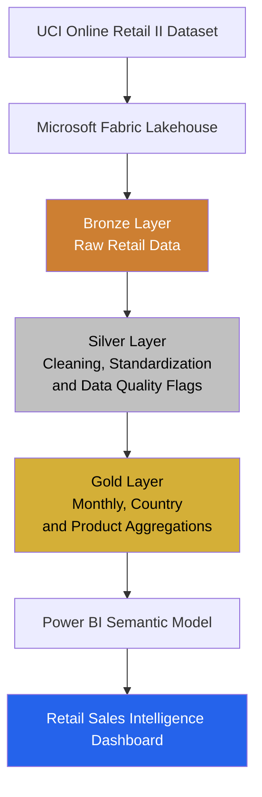

# End-to-End Retail Sales Intelligence Platform using Microsoft Fabric

An end-to-end data analytics project built using Microsoft Fabric and Power BI to transform retail transaction data into meaningful business insights.

## Project Overview

This project implements a Medallion Architecture (Bronze, Silver, and Gold) using Microsoft Fabric. The solution ingests retail transaction data, performs data cleaning and transformation, creates analytical tables, and presents insights through an interactive four-page Power BI report.

## Architecture

The project follows a medallion architecture to transform raw retail transactions into business-ready analytics.

### Key Components

- **Source:** UCI Online Retail II transaction dataset.
- **Bronze:** Ingests the original retail data into the Lakehouse.
- **Silver:** Standardizes fields, calculates sales amount, and flags cancellations, negative quantities, and missing customer IDs.
- **Gold:** Creates aggregated tables for monthly sales, country sales, and product performance.
- **Power BI:** Presents executive KPIs, geographic analysis, product performance, and data-quality insights.

The Microsoft Fabric pipeline orchestrates the Bronze → Silver → Gold processing sequence.

## Technologies Used

- Microsoft Fabric
- Fabric Lakehouse
- PySpark
- Python
- Power BI
- DAX
- Medallion Architecture
- Data quality validation and pipeline orchestration

## Pipeline Execution

The end-to-end pipeline runs the Bronze ingestion, Silver transformation, and Gold analytics notebooks in sequence.

## Lakehouse Tables

The Lakehouse contains the Bronze, Silver, and Gold tables used throughout the analytics workflow.

## Power BI Report

### 1. Executive Overview

Provides an overview of net sales value, net quantity, invoice counts across months, monthly sales trends, and top-performing countries.

### 2. Geographic Analysis

Compares country-level sales performance and identified customer counts.

### 3. Product Performance

Analyzes top products by net sales and net quantity, with a detailed product performance table.

### 4. Data Quality & Insights

Highlights missing customer identifiers, cancellation invoices, negative quantities, and invalid core-field records.

## Data Quality Findings

The Silver dataset contains approximately 1.067 million transaction rows.

| Data quality metric | Observed count |
|---|---:|
| Total transaction rows | 1,067,371 |
| Missing customer IDs | 243,007 |
| Cancellation invoice rows | 19,494 |
| Negative quantity rows | 22,950 |
| Invalid core-field rows | 0 |

Data quality flags are retained for analysis rather than automatically removing potentially meaningful transactions.

**Important considerations:**
- Cancellation invoices and negative quantities may overlap.
- Missing customer identifiers limit customer-level analysis.
- Net sales amount is calculated as quantity multiplied by unit price. It is not profit or independently audited revenue.
- Net quantity can include returns and adjustments.

## Gold Analytics Tables

| Gold table | Purpose | Row count |
|---|---|---:|
| `gold_retail_monthly_sales` | Monthly sales analysis | 25 |
| `gold_retail_country_sales` | Country-level performance | 43 |
| `gold_retail_product_sales` | Product-level performance | 8,991 |

These counts represent aggregation output sizes and do not, by themselves, establish full business correctness.

## Business Insights

Analysis of the Gold-layer tables revealed the following findings:

### 1. Country Sales Performance
- The **United Kingdom** recorded the highest net sales value among the countries returned by the country-ranking query, at **16,382,583.90**.
- This highlights the UK's importance in the retail dataset's sales performance.

### 2. Monthly Sales Trends
- **November 2011** was the highest-sales month in the monthly aggregation, with a net sales value of **1,461,756.25**.
- Sales were approximately **2.7% higher** than November 2010, which recorded **1,422,654.64**.

### 3. Product Sales Performance
- **REGENCY CAKESTAND…** ranked first in the product aggregation by net sales, at **327,813.65**.
- **DOTCOM POSTAGE** ranked second, at **322,647.47**. As this is a postage-related item, it should be distinguished from physical merchandise when interpreting product performance.

### Interpretation Notes
- Net sales amount represents the aggregated transaction value (`quantity × price`), not profit.
- Negative quantities and cancellation-related transactions are retained in the dataset and can affect net sales.
- These findings describe the available dataset and should not automatically be interpreted as audited revenue or future business forecasts.

## Key Learnings

- Implementing a Bronze–Silver–Gold data architecture.
- Ingesting and transforming large transaction datasets with PySpark.
- Creating analytical aggregation tables in a Lakehouse.
- Building and validating an end-to-end Fabric pipeline.
- Developing multi-page Power BI reports.
- Identifying and communicating data quality limitations.

## Data Source

UCI Machine Learning Repository: [Online Retail II Dataset](https://archive.ics.uci.edu/dataset/502/online+retail+ii)

## How to Run the Project

### Prerequisites
- Access to a Microsoft Fabric workspace with the required permissions and available capacity.
- A Lakehouse to store the project data.
- Power BI Desktop to explore the report.
- The source dataset: [UCI Online Retail II](https://archive.ics.uci.edu/dataset/502/online+retail+ii).

### Execution Steps
1. Download the source dataset from the UCI Machine Learning Repository.
2. Upload the source files to the appropriate location in the Fabric Lakehouse.
3. Run `nb_bronze_retail_ingestion` to ingest the source data into the Bronze layer.
4. Run `nb_silver_retail_transformation` to clean and transform the data into the Silver layer.
5. Run `nb_gold_retail_analytics` to generate the Gold-layer analytical tables.
6. Execute `pl_retail_sales_end_to_end` to orchestrate the end-to-end pipeline, after configuring the required notebook and Lakehouse references.
7. Open the Power BI report in the `powerbi/` folder to explore the dashboard.

### Notes
- Update workspace, Lakehouse, file paths, and other environment-specific references before running the notebooks.
- Microsoft Fabric capacity, permissions, and licensing can affect execution.
- The report and notebook outputs depend on the dataset version and transformation logic used.

## Author

**Samprath Shanbhag**

GitHub: [samprathshanbhag](https://github.com/samprathshanbhag)

LinkedIn: [Samprath Shanbhag](https://www.linkedin.com/in/samprath-shanbhag-27b587341)
