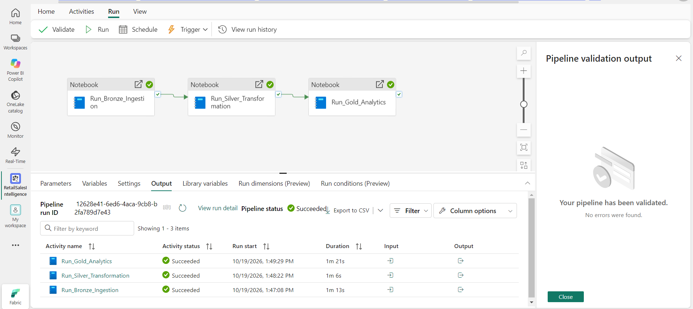
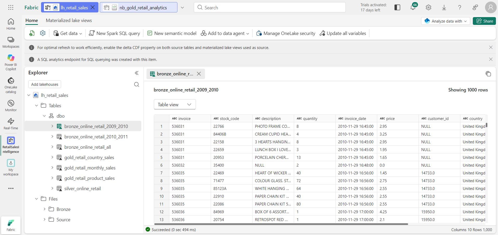
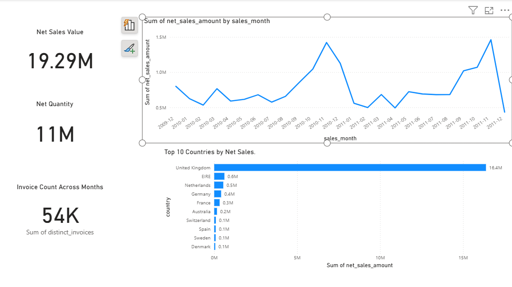
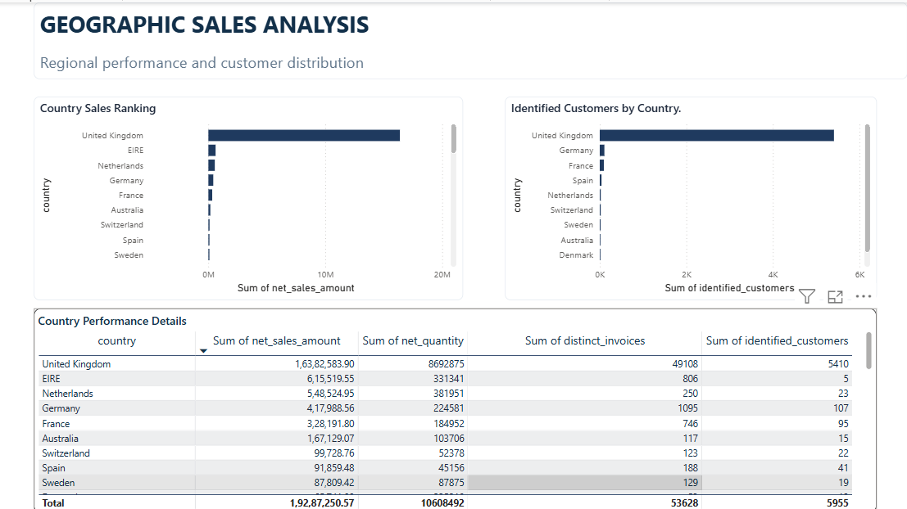
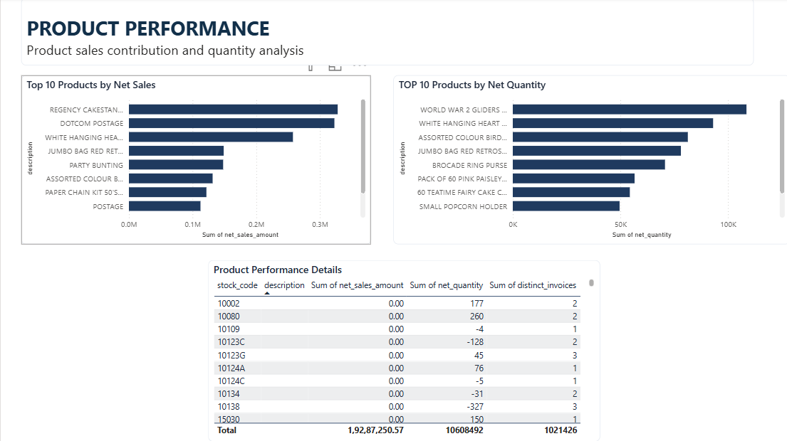
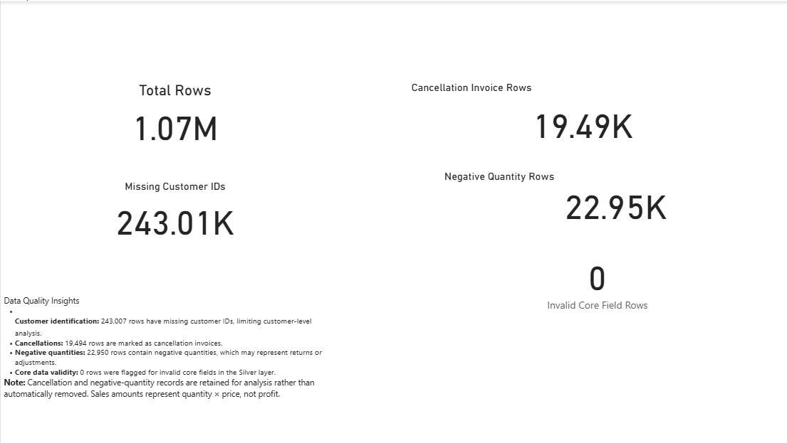

# End-to-End Retail Sales Intelligence Platform using Microsoft Fabric

An end-to-end data analytics project built using Microsoft Fabric and Power BI to transform retail transaction data into meaningful business insights.

## Project Overview

This project implements a Medallion Architecture (Bronze, Silver, and Gold) using Microsoft Fabric. The solution ingests retail transaction data, performs data cleaning and transformation, creates analytical tables, and presents insights through an interactive four-page Power BI report.

## Architecture

**Data Source → Bronze → Silver → Gold → Power BI**

- **Source:** UCI Online Retail II dataset
- **Bronze:** Ingests the original retail transaction data into Lakehouse tables.
- **Silver:** Standardizes data types, derives sales amounts, and identifies data quality issues.
- **Gold:** Creates aggregated datasets for monthly sales, country performance, and product performance.
- **Reporting:** Power BI report with four analytical pages.
- **Orchestration:** Microsoft Fabric pipeline coordinates the notebook activities.

## Technologies Used

- Microsoft Fabric
- Fabric Lakehouse
- PySpark
- Python
- Power BI
- DAX
- Medallion Architecture
- Data quality validation and pipeline orchestration

## Pipeline Execution

The end-to-end pipeline runs the Bronze ingestion, Silver transformation, and Gold analytics notebooks in sequence.

## Lakehouse Tables

The Lakehouse contains the Bronze, Silver, and Gold tables used throughout the analytics workflow.

## Power BI Report

### 1. Executive Overview

Provides an overview of net sales value, net quantity, invoice counts across months, monthly sales trends, and top-performing countries.

### 2. Geographic Analysis

Compares country-level sales performance and identified customer counts.

### 3. Product Performance

Analyzes top products by net sales and net quantity, with a detailed product performance table.

### 4. Data Quality & Insights

Highlights missing customer identifiers, cancellation invoices, negative quantities, and invalid core-field records.

## Data Quality Findings

The Silver dataset contains approximately 1.067 million transaction rows.

| Data quality metric | Observed count |
|---|---:|
| Total transaction rows | 1,067,371 |
| Missing customer IDs | 243,007 |
| Cancellation invoice rows | 19,494 |
| Negative quantity rows | 22,950 |
| Invalid core-field rows | 0 |

Data quality flags are retained for analysis rather than automatically removing potentially meaningful transactions.

**Important considerations:**
- Cancellation invoices and negative quantities may overlap.
- Missing customer identifiers limit customer-level analysis.
- Net sales amount is calculated as quantity multiplied by unit price. It is not profit or independently audited revenue.
- Net quantity can include returns and adjustments.

## Gold Analytics Tables

| Gold table | Purpose | Row count |
|---|---|---:|
| `gold_retail_monthly_sales` | Monthly sales analysis | 25 |
| `gold_retail_country_sales` | Country-level performance | 43 |
| `gold_retail_product_sales` | Product-level performance | 8,991 |

These counts represent aggregation output sizes and do not, by themselves, establish full business correctness.

## Key Learnings

- Implementing a Bronze–Silver–Gold data architecture.
- Ingesting and transforming large transaction datasets with PySpark.
- Creating analytical aggregation tables in a Lakehouse.
- Building and validating an end-to-end Fabric pipeline.
- Developing multi-page Power BI reports.
- Identifying and communicating data quality limitations.

## Data Source

UCI Machine Learning Repository: [Online Retail II Dataset](https://archive.ics.uci.edu/dataset/502/online+retail+ii)

## Author

**Samprath Shanbhag**

GitHub: [samprathshanbhag](https://github.com/samprathshanbhag)

LinkedIn: [Samprath Shanbhag](https://www.linkedin.com/in/samprath-shanbhag-27b587341)
